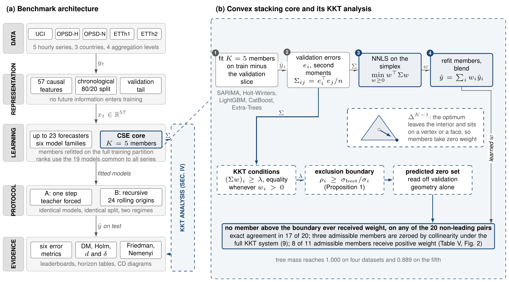
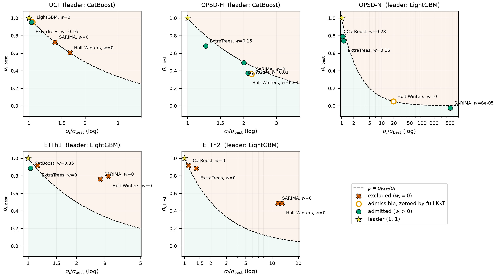
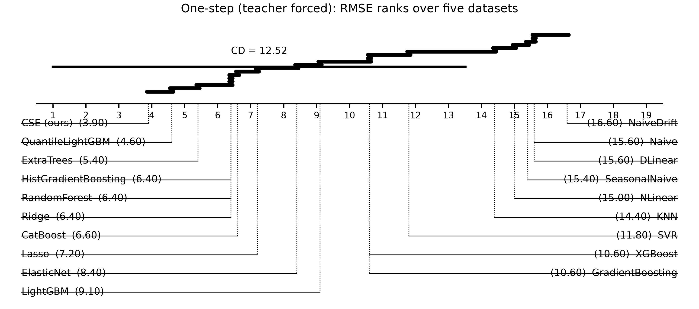

# Convex Forecast Combination and Sparsity via KKT Boundaries: Multi-Dataset Benchmarking in Energy Time Series

Companion code for the manuscript under submission to *IEEE Transactions on Smart Grid*. Convex stacking over classical and tree forecasters collapses onto tree learners; a KKT boundary predicts which members receive zero weight.

[](LICENSE)
[](requirements.txt)
[](CITATION.cff)
[](CITATION.cff)



## Summary

A **Convex Stacking Ensemble (CSE)** blends five members (SARIMA, Holt–Winters, LightGBM, CatBoost, Extra-Trees) with non-negative least squares on a validation tail, then projects weights onto the simplex and refits members on the full training set. Under recursion the ensemble rolls out as one unit.

Because validation errors of weaker members are often large and highly correlated with the best tree, the simplex optimum puts nearly all mass on trees. The KKT geometry of that problem yields an exclusion boundary $\rho_i \ge \sigma_{\mathrm{best}}/\sigma_i$: members above it take weight exactly zero. Details: [`docs/method.md`](docs/method.md).

## Key results

Every number links to a file under [`results/`](results/). Rank definition: `scipy.stats.rankdata(method="average")` on the 19 models shared by all five series ([`docs/rank_and_dm.md`](docs/rank_and_dm.md)).

| Claim | Value | Source |
|-------|-------|--------|
| Tree mass of CSE weights (exact simplex solver) | 1.000 on four series; 0.965 on OPSD household | [`results/cse_weights_by_dataset.csv`](results/cse_weights_by_dataset.csv) |
| Exact single-member collapse | ETTh2 → LightGBM weight 1.0 | same |
| Pairwise screen vs simplex zeros | 17/20 exact; 9 excluded, none with weight; 11 admissible, 8 with positive weight; full KKT system holds for 25/25 members | same (+ `results/tables/kkt_simplex_recheck.csv`) |
| OPSD-N SARIMA scale | validation RMSE ≈ 508× the leader (uncentred); weight ≈ 5.5e-5 | same |
| Friedman (one-step RMSE) | χ² ≈ 52.6, p ≈ 3×10⁻⁵ (ETT rows refit; see CHANGELOG) | [`results/significance/friedman_summary.csv`](results/significance/friedman_summary.csv) |
| Friedman (recursive RMSE) | χ² ≈ 19.2, p ≈ 0.38 | same |
| CSE mean rank (one-step) | **3.9** (best of 19) | [`results/leaderboards.csv`](results/leaderboards.csv) |
| CSE vs RMSE leader (Holm α=0.05) | win OPSD-N; tie ETTh2 & UCI; **loss ETTh1 & OPSD household** | [`results/significance/dm_matrix__*__one_step.csv`](results/significance/) |
| CSE training cost | about 50 to 4000 times HistGradientBoosting across the five datasets, median near 360 | [`results/leaderboards.csv`](results/leaderboards.csv) |

Numbers above marked as refit reflect the exact simplex solver on ETTh1 and ETTh2; the CSE test rows of UCI and the two OPSD series are regenerated by `python scripts/rerun_cse.py` (see `CHANGELOG.md`). The manuscript in `paper/` reads every number from `results/` through `scripts/build_paper.py`.

Negative results are intentional: under one-step evaluation CSE is not uniformly best. Losses (significant vs the RMSE leader): **ETTh1** (vs Ridge) and **OPSD_DE_household** (vs QuantileLightGBM). See [`docs/rank_and_dm.md`](docs/rank_and_dm.md).

## Figures





Map: [`docs/figure_map.md`](docs/figure_map.md).

## Install

```bash
python3.12 -m venv .venv && source .venv/bin/activate
pip install -r requirements.txt
make data          # or: place files per DATA.md
make smoke         # < 2 minutes, CPU
```

Optional GPU / Streamlit: `pip install -r requirements-optional.txt`.

## Reproduce

Hardware assumption: **CPU only** for all published artefacts. Seeds fixed at **42** (`src.seed.set_global_seed`).

| Target | What it does | Typical runtime |
|--------|--------------|-----------------|
| `make data` | Download five series into `data/raw/`, verify SHA-256 | minutes (network) |
| `make features` | Build 57-column frame on ETTh1 | < 1 min |
| `make smoke` | Tiny UCI path check | < 2 min |
| `make benchmark` | One-step + recursive leaderboards | many hours |
| `make rolling` | Rolling-origin horizons → `results/multistep_rolling/` | many hours |
| `make stats` | DM, Friedman, KKT PDF | minutes |
| `make figures` | `figures/figN_*.png` + `.pdf` | minutes |
| `make tables` | CSV + LaTeX under `results/tables/` | < 1 min |
| `make verify` | Assert headline claims | < 1 min |
| `make all` | Full chain end to end | day-scale |

A clone that already includes `results/` can run `make verify && make figures && make tables` without retraining.

## Repository map

| Path | Role |
|------|------|
| `src/` | Library (models, features, evaluation, pipeline) |
| `src/cse/` | Paper-facing CSE package (re-exports; FAHE ≡ CSE) |
| `scripts/` | Download, benchmark, rolling, stats, figures, tables, verify |
| `results/` | All published artefacts ([`results/README.md`](results/README.md)) |
| `figures/` | Regenerated manuscript figures |
| `paper/` | TikZ sources |
| `docs/` | Method, feature list, figure/table maps |
| `extras/` | Optional Streamlit UI |
| `tests/` | Unit tests |

## Scope and limitations

- **No Transformer results.** Autoformer, FEDformer, Informer, iTransformer, PatchTST and related models exist as optional code paths (`src/models/optional_dl.py`) and produced **no** artefacts; they appear in no result in the paper.
- **OPSD-N carries 19 models, not 23**, because standalone heavy classical fits exceeded the memory budget. CSE still keeps internal SARIMA and Holt–Winters branches there.
- Horizon tables use **`results/multistep_rolling/` only**. `results/multistep/` is a diagnostic prefix table and must not be cited.
- Single chronological split per dataset; seeds fixed at 42.
- Under one-step evaluation, CSE wins on one dataset, ties on two, and loses on two (Holm-adjusted DM vs the RMSE leader; see Key results).

## Naming map

| Code / CSV | Manuscript |
|------------|------------|
| `FAHE`, `FAHEForecaster`, `FAHE (Ours)` | **CSE** (Convex Stacking Ensemble) |
| `CSEForecaster`, `CSE (Ours)` | Preferred alias for the same class |

They are **one method**, not two.

## Citation

Please cite the **paper**, not only this repository. Metadata: [`CITATION.cff`](CITATION.cff).

```bibtex
@article{singh2026convex,
  title={Convex Forecast Combination and Sparsity via {KKT} Boundaries:
         Multi-Dataset Benchmarking in Energy Time Series},
  author={Singh, Aryan Kumar and Al Farid, Fahmid and Al Qwaid, Marran
          and Miah, Abu Saleh Musa and Islam, Syed Mohammed Shamsul
          and Husen, Mohd Nizam},
  journal={IEEE Transactions on Smart Grid (under submission)},
  year={2026},
  note={DOI pending}
}
```

## Licence, contact, acknowledgements

- Code and documentation: [Apache License 2.0](LICENSE). See [NOTICE](NOTICE).
- Datasets: upstream terms only — [DATA.md](DATA.md).
- Corresponding author: Aryan Kumar Singh — <PUT THE ADDRESS YOU WANT HERE> — ORCID [0009-0003-8791-1869](https://orcid.org/0009-0003-8791-1869) — [github.com/aksingh1608](https://github.com/aksingh1608).

Feature column listing for methods text: [`docs/features.md`](docs/features.md).
